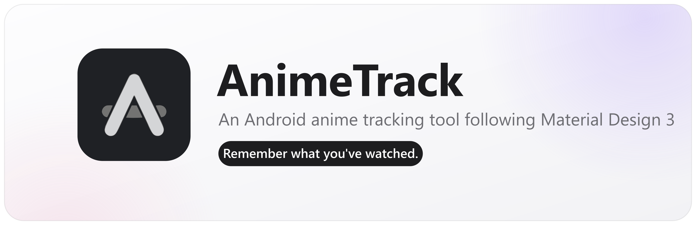
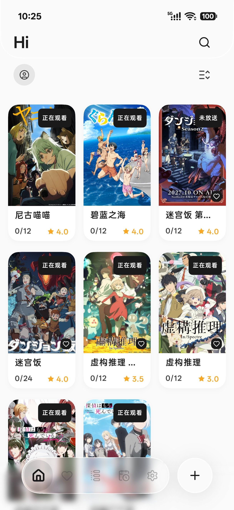
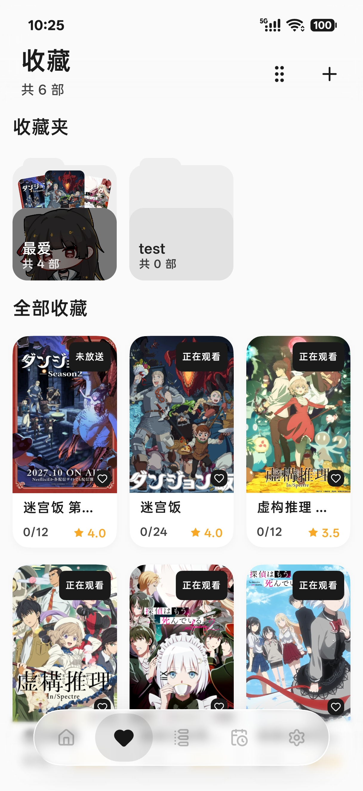
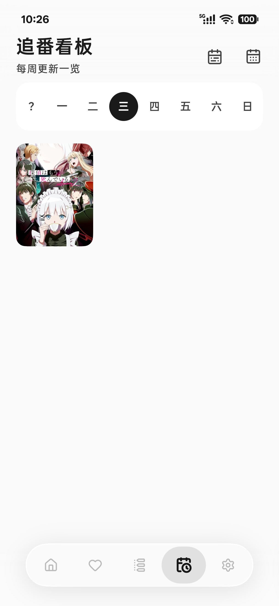
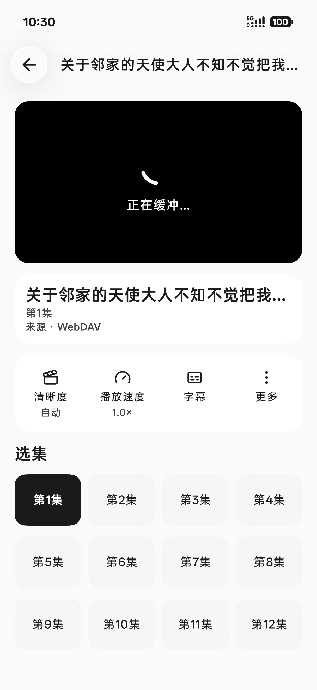
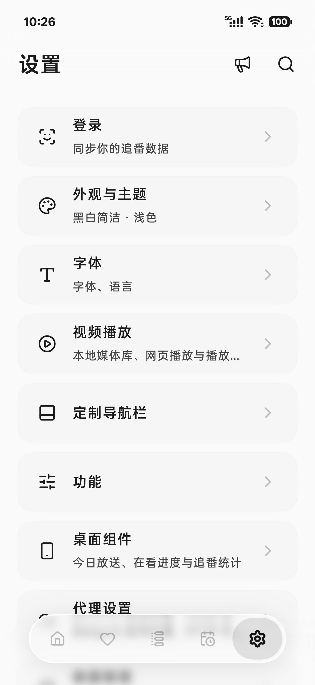
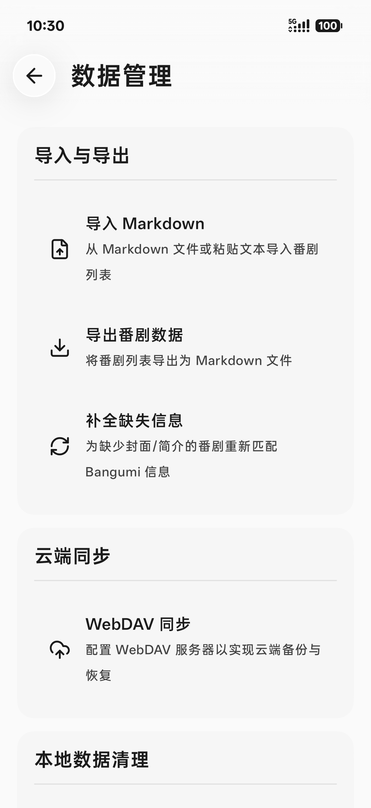
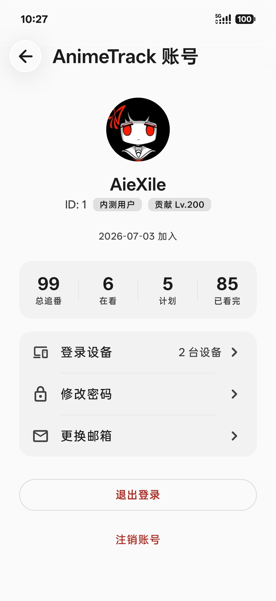
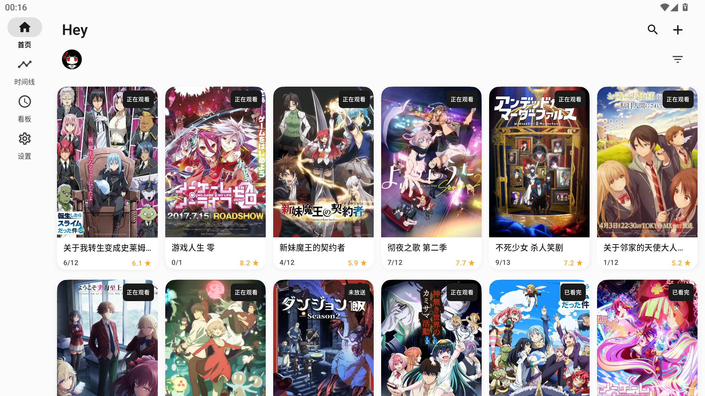
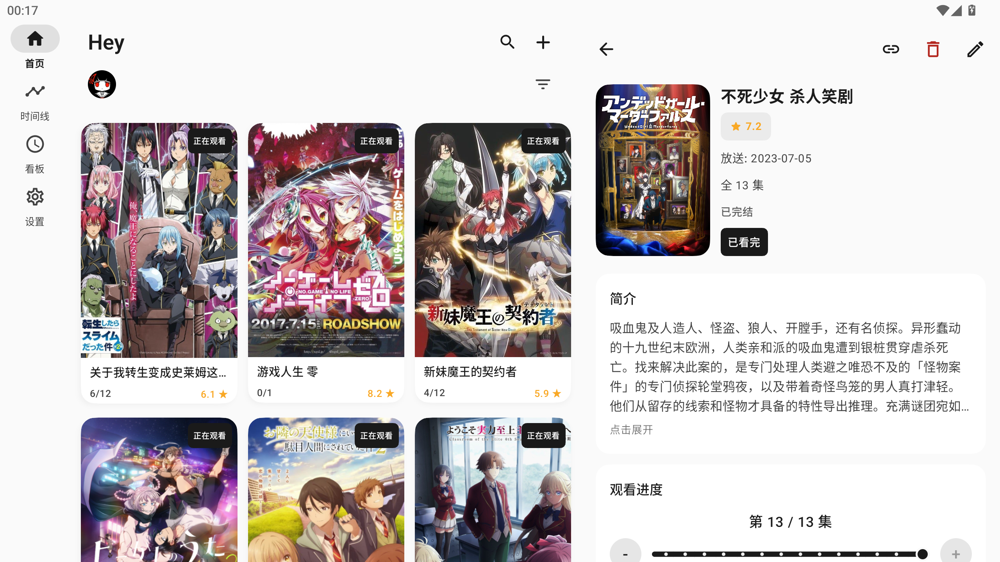

<p align="center">
  
</p>

<p align="center"><strong>Remember what you watched.</strong><br>AnimeTrack is an open-source Android app for organizing your watchlist, following weekly airings, and picking up where you left off.</p>

<p align="center">
  <a href="https://github.com/AieXile/AnimeTrack/releases/latest"><strong>Download APK</strong></a> ·
  <a href="https://github.com/AieXile/AnimeTrack/releases">Release notes</a> ·
  <a href="https://github.com/AieXile/AnimeTrack/issues">Report an issue</a>
</p>

<p align="center">
  <a href="https://github.com/AieXile/AnimeTrack/releases/latest"></a>
  <a href="https://github.com/AieXile/AnimeTrack/stargazers"></a>
  
  <a href="LICENSE"></a>
</p>

<p align="center"><a href="README.md">简体中文</a> · <strong>English</strong> · <a href="README.ja.md">日本語</a></p>

<p align="center"><a href="#get-started">Get started</a> · <a href="#tracking-and-favorites">Tracking</a> · <a href="#video-playback">Playback</a> · <a href="#sync-and-backups">Sync and backups</a> · <a href="#development-and-contributions">Contribute</a></p>

<table>
  <tr>
    <td align="center"><a href="assets/readme/home.jpg"></a><br><strong>Anime library</strong></td>
    <td align="center"><a href="assets/readme/favorites.jpg"></a><br><strong>Favorites</strong></td>
    <td align="center"><a href="assets/readme/weekly-board.jpg"></a><br><strong>Weekly airings</strong></td>
  </tr>
</table>

## Get started

[Download the Android APK](https://github.com/AieXile/AnimeTrack/releases/latest) under **Assets**. AnimeTrack requires **Android 8.0 (API 26) or later**.

| APK | Which one to choose |
| --- | --- |
| `-v8a.apk` | Most recent Android phones and tablets |
| `-v7a.apk` | 32-bit ARM devices |
| `-universal.apk` | Use this if you're unsure which architecture your device uses |

Open the APK and follow Android's installation prompts. You can install it over an existing GitHub release.

- **Add your first anime.** Tap **+** on the home screen, search for a title, and choose a watch status. Open the title to update your episode count or rating.
- **Bring over your watch history.** Import from Bangumi or Bilibili. For Markdown imports and WebDAV restores, open **Settings → Data Management**. See [Sync and backups](#sync-and-backups) for the available options.
- **Play your own videos.** Open **Settings → Video Playback** to grant access to a local folder, configure a WebDAV media directory, or paste a supported video link. See [Video playback](#video-playback) for source and progress options.

## Tracking and favorites

- **Build your library with Bangumi and TMDB.** Search for titles and bring in covers, episode counts, and air dates. Add an entry manually or match missing metadata later. In batch mode, keep selecting results as you change queries or sources, then add them in one go.
- **Keep a record of every episode.** Mark shows as planned, watching, or completed, and save ratings and notes. Search, sort, or pin titles in a list or grid. The timeline lets you revisit what you finished by month.
- **Browse seasons together.** AnimeTrack uses Bangumi prequel and sequel relationships alongside season names. Swipe through the resulting stacks to see each season's progress.
- **Organize favorites in your own folders.** Pick a cover and drag to reorder folders or their titles. Pinch a folder closed when you're done. Removing a folder keeps its shows in All Favorites.
- **See the week at a glance.** The airing board shows when the ongoing titles you've added are due. Home-screen widgets show today's airings, watch progress, and stats.

## Video playback

The built-in player is available starting with **v1.0.0**. Enable the detail-page play button under **Settings → Features** to pick an episode or resume a linked video directly from its anime entry.

| Source | What you can do |
| --- | --- |
| Local files | Grant access to a folder. AnimeTrack scans it and groups files by title, season, and episode. Rescan changed files and confirm or correct matches individually or in groups. |
| WebDAV | Test the server connection, browse the original folders, or scan them into a library grouped by title. Pick episodes, resume playback, and load supported subtitles from the same directory. |
| Web | Play direct MP4, HLS (M3U8), or DASH links, parse episodes and sources from supported pages, or search by title using compatible Kazumi HTML or API rules. |
| External apps | Open eligible titles in supported apps such as Animeko or Bilibili from the detail page. Available options depend on the linked title and your preferences. |

- **Media library and Continue Watching.** Filter titles by local, web, or WebDAV source. Add web titles to the library and return to a previous episode.
- **Update your watch progress automatically.** Turn on **Update Watch Progress When Finished** to track episodes with a confirmed match and episode number. Watch time determines completion, and consecutive completed episodes advance your progress.
- **Playback controls.** Pick episodes in portrait or go full screen with orientation matched to the video. Seek, adjust brightness or volume, and hold to speed up. Change the aspect ratio, choose available quality, audio and subtitle tracks, load an external subtitle file, or switch to picture-in-picture.
- **Separate WebDAV settings.** Manage media servers and media roots in Video playback. Set up data backups in Data management.

<p align="center"><a href="assets/readme/player.jpg"></a><br><sub>Portrait player and episode selection</sub></p>

## Sync and backups

| Method | What it does |
| --- | --- |
| **AnimeTrack account** | Sync watch records across devices and manage your profile, signed-in devices, password, and email. |
| **Bangumi** | Sync collection status and episode progress in both directions. |
| **Bilibili** | Sign in and choose which followed titles to import into the local library. |
| **WebDAV** | Back up manually or on a schedule, and merge or replace local data when restoring. JSON includes favorite folders and custom folder covers. Full ZIP also includes anime covers. |
| **Markdown** | Import files or pasted text with status, episode progress, completion dates, and notes. Export your library as a readable Markdown file. |

Watch records are stored locally. In Data management, you can also match missing metadata or review and remove duplicate records.

## Appearance and tools

- Choose standard, advanced blur, or liquid glass. Customize color presets, dynamic colors, four dark styles, fonts, icons, and the bottom navigation layout. Real-time blur and dynamic system colors require Android 12 (API 31) or later.
- Browse an adaptive grid on phones and a two-pane layout for library details or settings on larger screens.
- Find or replace cover images, save covers locally, and share cards with a title's cover, rating, and progress.
- Review usage and tracking stats by day, month, or year. Search settings directly, configure an HTTP or Bangumi proxy, and check updates or announcements in the app.

<details>
<summary>Show settings, data management, and the account screen</summary>

<table>
  <tr>
    <td align="center"><a href="assets/readme/settings.jpg"></a><br><sub>Settings and appearance</sub></td>
    <td align="center"><a href="assets/readme/data-management.jpg"></a><br><sub>Data management</sub></td>
    <td align="center"><a href="assets/readme/account.jpg"></a><br><sub>AnimeTrack account</sub></td>
  </tr>
</table>

</details>

<table>
  <tr>
    <td align="center"><a href="update/screenshots/tablet_home.png"></a><br><sub>Library on a tablet</sub></td>
    <td align="center"><a href="update/screenshots/tablet_detail_pane.png"></a><br><sub>Two-pane details on a tablet</sub></td>
  </tr>
</table>

## Open protocol

The [`anime-play://` specification](docs/ANIME_PLAY_LINK_PROTOCOL.md) lets anime apps point to a Bangumi subject and episode. A compatible receiving app can open the requested episode and use the supplied callback to report progress.

```text
anime-play://subject/12345?ep=3&src=animetrack
```

AnimeTrack can send these links from anime detail pages. If you maintain a tracker or player, see the [full specification](docs/ANIME_PLAY_LINK_PROTOCOL.md) for fields, Android examples, and progress callbacks.

## Development and contributions

The Android client uses Kotlin, Jetpack Compose, and Material 3, with Room and DataStore for local data and WorkManager for background scanning and sync. Builds require JDK 21 and Android SDK Platform 37.1.

```sh
./gradlew :app:assembleDebug
```

On Windows PowerShell, use `.\gradlew.bat :app:assembleDebug`.

Open an [issue](https://github.com/AieXile/AnimeTrack/issues) or submit a pull request. Find the community on [Telegram](https://t.me/AnimeTrackovo) or in [QQ group 951059178](https://qun.qq.com/universal-share/share?ac=1&authKey=ToBlat%2BYBVr8R8J4kRqz5dZrwO08fUn1zJ47jsHDUmn04oxTLfipUhzDJNijY%2F3P&busi_data=eyJncm91cENvZGUiOiI5NTEwNTkxNzgiLCJ0b2tlbiI6IlgwRENkOGxubGFFOVd2cHZyRXNyQWsyU3VNb05DZ3ltNXpmUlg5T1NhQlh4emNoSDU1YnhWOWtUT2tFd1JLYlMiLCJ1aW4iOiIxMjE5NTc2NDA4In0%3D&data=f0HExdxeoQoLo-3m3KP-nlq9fIdMzKA3V5heiCbyagsnJqZRpLtjMq0yZ4W7BFNzDW9f17-YL24xP87SezjzCQ&svctype=4&tempid=h5_group_info).

## License

The client is distributed under the [Apache License 2.0](LICENSE). The bundled kotlin-anitomy source is distributed under the [MPL 2.0](app/src/main/assets/kotlin-anitomy-NOTICE.txt). See the [web rules notice](app/src/main/assets/websource/KazumiRules-NOTICE.txt) for attribution.
