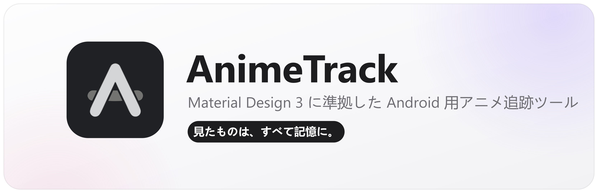
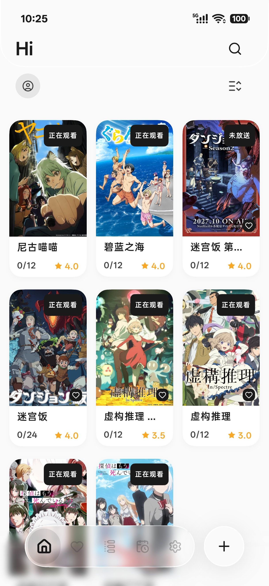
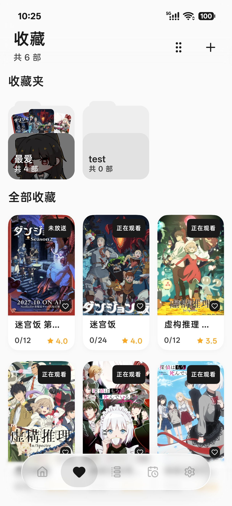
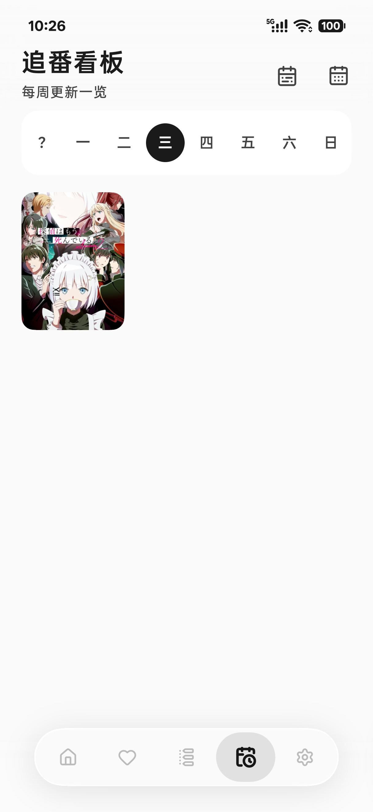
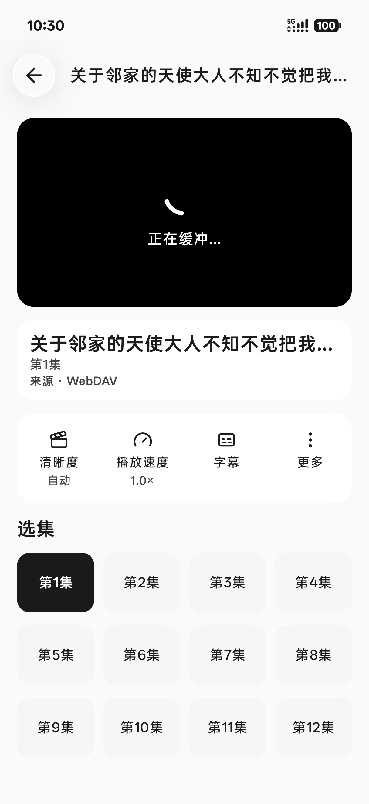
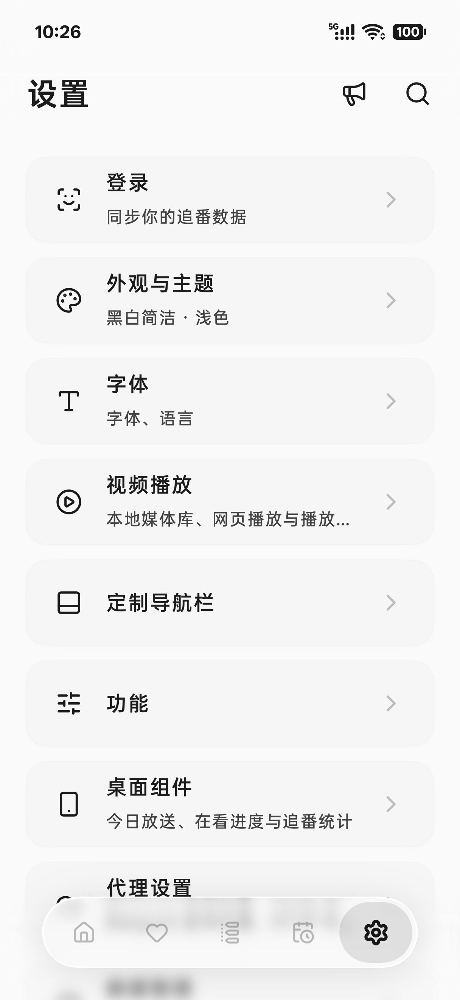
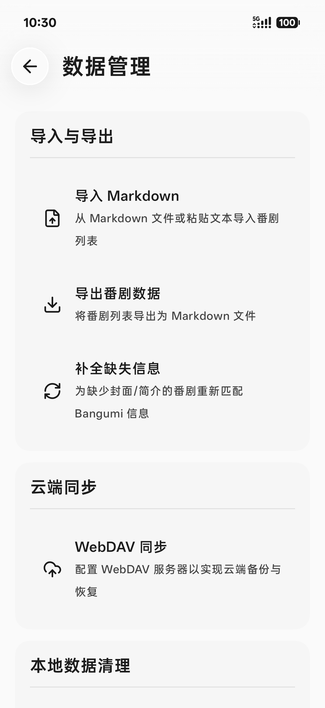
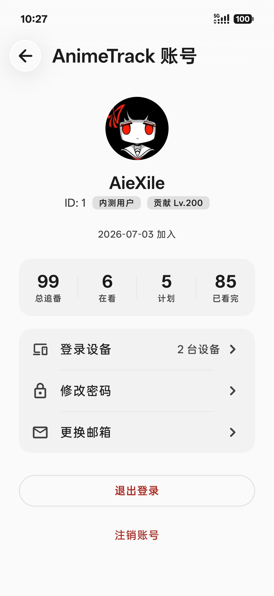
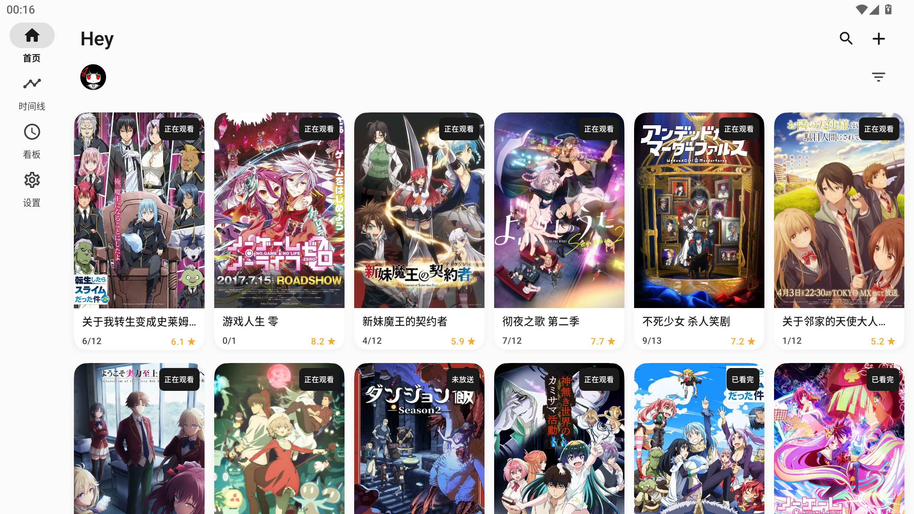
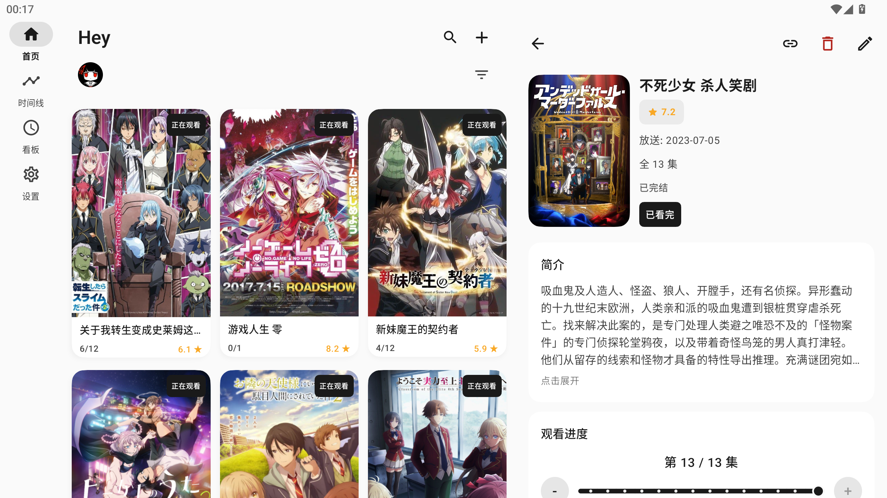

<p align="center">
  
</p>

<p align="center"><strong>見たアニメを、忘れない。</strong><br>見たい作品を整理し、毎週の放送をチェックして、前回の続きから再生できるオープンソースの Android アプリです。</p>

<p align="center">
  <a href="https://github.com/AieXile/AnimeTrack/releases/latest"><strong>APK をダウンロード</strong></a> ·
  <a href="https://github.com/AieXile/AnimeTrack/releases">更新履歴</a> ·
  <a href="https://github.com/AieXile/AnimeTrack/issues">不具合を報告</a>
</p>

<p align="center">
  <a href="https://github.com/AieXile/AnimeTrack/releases/latest"></a>
  <a href="https://github.com/AieXile/AnimeTrack/stargazers"></a>
  
  <a href="LICENSE"></a>
</p>

<p align="center"><a href="README.md">简体中文</a> · <a href="README.en.md">English</a> · <strong>日本語</strong></p>

<p align="center"><a href="#はじめに">はじめに</a> · <a href="#視聴記録とお気に入り">視聴記録</a> · <a href="#動画再生">動画再生</a> · <a href="#同期とバックアップ">同期とバックアップ</a> · <a href="#開発とコントリビューション">開発と貢献</a></p>

<table>
  <tr>
    <td align="center"><a href="assets/readme/home.jpg"></a><br><strong>アニメ一覧</strong></td>
    <td align="center"><a href="assets/readme/favorites.jpg"></a><br><strong>お気に入り</strong></td>
    <td align="center"><a href="assets/readme/weekly-board.jpg"></a><br><strong>週間放送予定</strong></td>
  </tr>
</table>

## はじめに

[Android 用 APK](https://github.com/AieXile/AnimeTrack/releases/latest) を **Assets** からダウンロードします。**Android 8.0（API 26）以降**が必要です。

| APK | 対象端末 |
| --- | --- |
| `-v8a.apk` | 多くの新しい Android スマートフォンやタブレット |
| `-v7a.apk` | 32 ビット ARM 端末 |
| `-universal.apk` | 端末のアーキテクチャがわからない場合 |

APK を開き、Android の案内に従ってインストールします。GitHub の正式版を利用している場合は、そのまま上書きで更新できます。

- **最初の作品を登録する。** ホーム画面の「＋」から作品を検索し、視聴状況を選びます。登録後は作品詳細で視聴話数や評価を更新できます。
- **今までの視聴記録を引き継ぐ。** Bangumi や Bilibili から取り込めます。Markdown のインポートや WebDAV からの復元は「設定 → データ管理」にあります。詳しくは[同期とバックアップ](#同期とバックアップ)をご覧ください。
- **手持ちの動画を再生する。** 「設定 → 動画再生」で端末のフォルダーや WebDAV のメディアディレクトリを登録するか、対応する動画リンクを貼り付けます。詳しくは[動画再生](#動画再生)をご覧ください。

## 視聴記録とお気に入り

- **Bangumi と TMDB で作品を探す。** 検索結果からカバー画像、話数、放送日を取り込めます。手動での追加や、あとからの情報補完にも対応しています。一括追加では検索語やデータソースを切り替えても選択が残ります。
- **視聴話数を記録する。** 作品を「見たい」「視聴中」「視聴済み」に分類し、評価やメモも保存できます。ホーム画面では表示の切り替え、検索、並べ替え、ピン留めができ、タイムラインでは見終わった作品を月ごとに振り返れます。
- **同じシリーズをまとめて表示する。** Bangumi の前作・続編情報とタイトルのシーズン表記を使って作品をまとめます。重なったカードをスワイプするとシーズンを切り替えられます。
- **お気に入りをフォルダーに整理する。** フォルダーのカバーを選んで、フォルダーや中の作品をドラッグで並べ替えられます。フォルダーはピンチインで閉じられ、削除後も作品は「すべてのお気に入り」に残ります。
- **1週間の放送予定を確認する。** 週間放送ボードに登録済みの放送中作品が表示されます。今日の放送、視聴進捗、視聴統計はホーム画面のウィジェットでも確認できます。

## 動画再生

内蔵プレーヤーは **v1.0.0** から正式に利用できます。**設定 → 機能** で作品詳細の再生ボタンを有効にすると、話数を選んだり、関連付けた動画の続きから再生したりできます。

| ソース | できること |
| --- | --- |
| ローカルファイル | 動画フォルダーを指定すると、作品・シーズン・話数で整理できます。差分スキャン、作品情報の補完、グループ単位とファイル単位の修正に対応しています。 |
| WebDAV | 接続をテストし、元のフォルダーから再生するか、スキャンして作品別に表示できます。エピソード選択、続きからの再生、同じフォルダー内の字幕照合に対応しています。 |
| ウェブ | MP4、HLS（M3U8）、DASH などの直リンクを再生できます。対応ページの話数や配信元を解析したり、互換性のある Kazumi HTML / API ルールで作品名を検索したりできます。 |
| 外部アプリ | 作品の関連付けや設定に応じて、作品詳細から対応する Animeko や Bilibili を起動できます。 |

- **メディアライブラリと続きからの再生。** ローカル、ウェブ、WebDAV で絞り込めます。ウェブの作品をライブラリに登録して、前回のエピソードから再開できます。
- **見終わった話数を自動で記録。** 視聴完了時の進捗更新を有効にすると、作品と話数が確定したエピソードは実際の視聴時間に応じて視聴済みになります。連続して見終えた話数まで視聴記録が進みます。
- **プレーヤーの操作。** 縦画面で話数を選べます。全画面では動画の縦横比に合わせて画面の向きを切り替えられます。シーク、明るさと音量の調整、長押しでの早送り、画質や音声・字幕の切り替え、外部字幕、ピクチャーインピクチャーに対応しています。
- **WebDAV の設定。** 再生用のサーバーとメディアルートは「動画再生」で、データのバックアップ先は「データ管理」で設定します。

<p align="center"><a href="assets/readme/player.jpg"></a><br><sub>縦画面のプレーヤーとエピソード選択</sub></p>

## 同期とバックアップ

| 方法 | できること |
| --- | --- |
| **AnimeTrack アカウント** | 複数の端末で視聴記録を同期し、プロフィール、ログイン端末、パスワード、メールアドレスを管理できます。 |
| **Bangumi** | コレクションと視聴話数を双方向で同期できます。 |
| **Bilibili** | ログイン後、取り込む追跡作品を選択できます。 |
| **WebDAV** | 手動または定期的にバックアップし、上書きや統合で復元できます。JSON にはお気に入りフォルダーとカバーが、完全 ZIP には作品のカバー画像も含まれます。 |
| **Markdown** | ファイルや貼り付けたテキストから状態、視聴話数、視聴完了日、メモを取り込めます。作品リストを Markdown ファイルにも書き出せます。 |

視聴記録は端末に保存されます。データ管理では、情報が不足した作品の再照合や、重複した記録の確認と整理もできます。

## 外観と便利な機能

- 標準、高度なぼかし、リキッドガラスの各スタイルに対応しています。配色、システムのダイナミックカラー、4種類のダークスタイル、フォント、アイコン、ナビゲーションを調整できます。リアルタイムのぼかしとシステムのダイナミックカラーには Android 12（API 31）以降が必要です。
- スマートフォンでは画面幅に応じてグリッドが変わり、タブレットでは一覧と詳細、または設定を2ペインで表示できます。
- カバーを検索、変更、保存したり、評価や進捗を載せたカードを共有したりできます。
- 利用時間と追加・完了した作品数を日、月、年ごとに確認できます。設定の検索、Bangumi / HTTP プロキシ、アプリの更新確認やお知らせ表示にも対応しています。

<details>
<summary>設定、データ管理、アカウント画面を見る</summary>

<table>
  <tr>
    <td align="center"><a href="assets/readme/settings.jpg"></a><br><sub>設定と外観</sub></td>
    <td align="center"><a href="assets/readme/data-management.jpg"></a><br><sub>データ管理</sub></td>
    <td align="center"><a href="assets/readme/account.jpg"></a><br><sub>AnimeTrack アカウント</sub></td>
  </tr>
</table>

</details>

<table>
  <tr>
    <td align="center"><a href="update/screenshots/tablet_home.png"></a><br><sub>タブレットの一覧画面</sub></td>
    <td align="center"><a href="update/screenshots/tablet_detail_pane.png"></a><br><sub>タブレットの2ペイン表示</sub></td>
  </tr>
</table>

## オープンプロトコル

[`anime-play://` 仕様](docs/ANIME_PLAY_LINK_PROTOCOL.md)を使うと、対応アプリ間で Bangumi の作品 ID と話数を受け渡せます。受け取り側で対象のエピソードを開き、指定されたコールバックで視聴進捗を返すこともできます。

```text
anime-play://subject/12345?ep=3&src=animetrack
```

AnimeTrack からは作品詳細を起点に対応アプリを開けます。視聴管理アプリやプレーヤーに組み込む場合は、パラメーター、Android の実装例、進捗の返し方をまとめた[仕様書](docs/ANIME_PLAY_LINK_PROTOCOL.md)をご覧ください。

## 開発とコントリビューション

Android クライアントは Kotlin、Jetpack Compose、Material 3 で開発しています。Room と DataStore でデータを保存し、WorkManager でバックグラウンドのスキャンと同期を行います。ビルドには JDK 21 と Android SDK Platform 37.1 が必要です。

```sh
./gradlew :app:assembleDebug
```

Windows PowerShell では `.\gradlew.bat :app:assembleDebug` を実行してください。

不具合や要望は [Issue](https://github.com/AieXile/AnimeTrack/issues) へお寄せください。Pull Request も歓迎します。[Telegram](https://t.me/AnimeTrackovo) や [QQ グループ 951059178](https://qun.qq.com/universal-share/share?ac=1&authKey=ToBlat%2BYBVr8R8J4kRqz5dZrwO08fUn1zJ47jsHDUmn04oxTLfipUhzDJNijY%2F3P&busi_data=eyJncm91cENvZGUiOiI5NTEwNTkxNzgiLCJ0b2tlbiI6IlgwRENkOGxubGFFOVd2cHZyRXNyQWsyU3VNb05DZ3ltNXpmUlg5T1NhQlh4emNoSDU1YnhWOWtUT2tFd1JLYlMiLCJ1aW4iOiIxMjE5NTc2NDA4In0%3D&data=f0HExdxeoQoLo-3m3KP-nlq9fIdMzKA3V5heiCbyagsnJqZRpLtjMq0yZ4W7BFNzDW9f17-YL24xP87SezjzCQ&svctype=4&tempid=h5_group_info) でも交流できます。

## ライセンス

クライアントは [Apache License 2.0](LICENSE) で配布しています。同梱する kotlin-anitomy ソースは [MPL 2.0](app/src/main/assets/kotlin-anitomy-NOTICE.txt) に従います。ウェブルールの出典は[ライセンス表示](app/src/main/assets/websource/KazumiRules-NOTICE.txt)をご覧ください。
