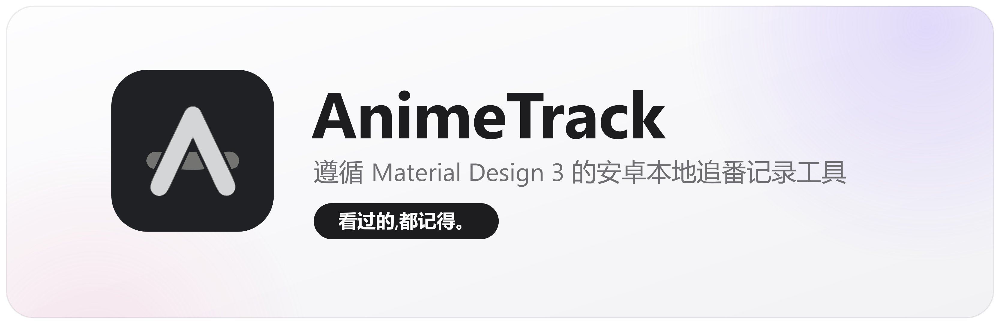
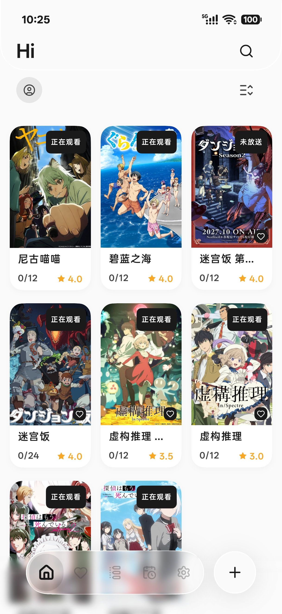
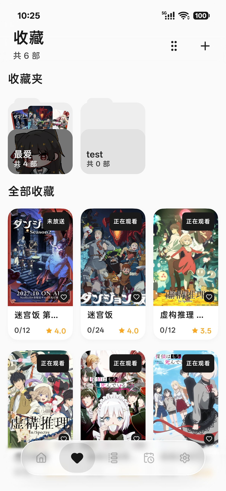
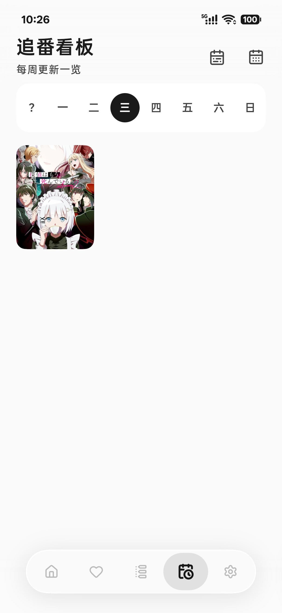
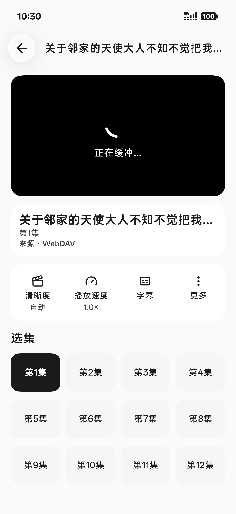
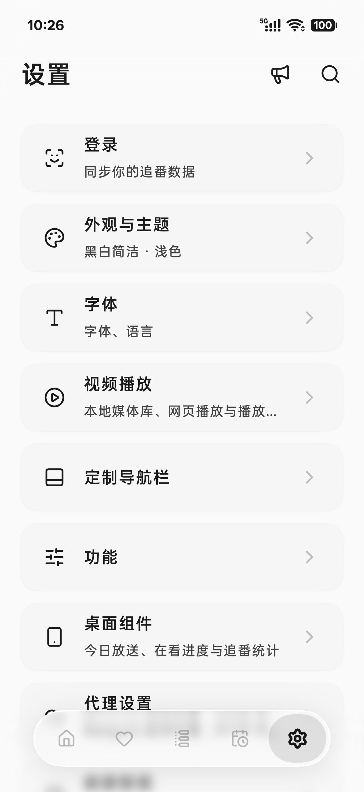
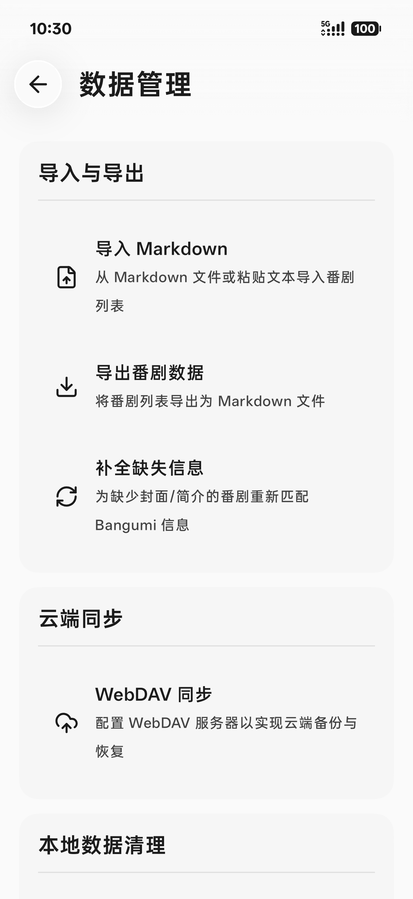
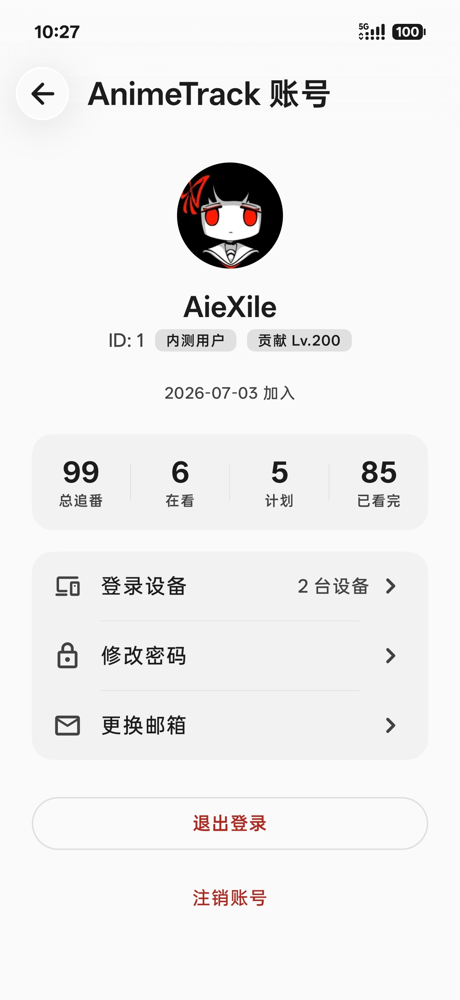
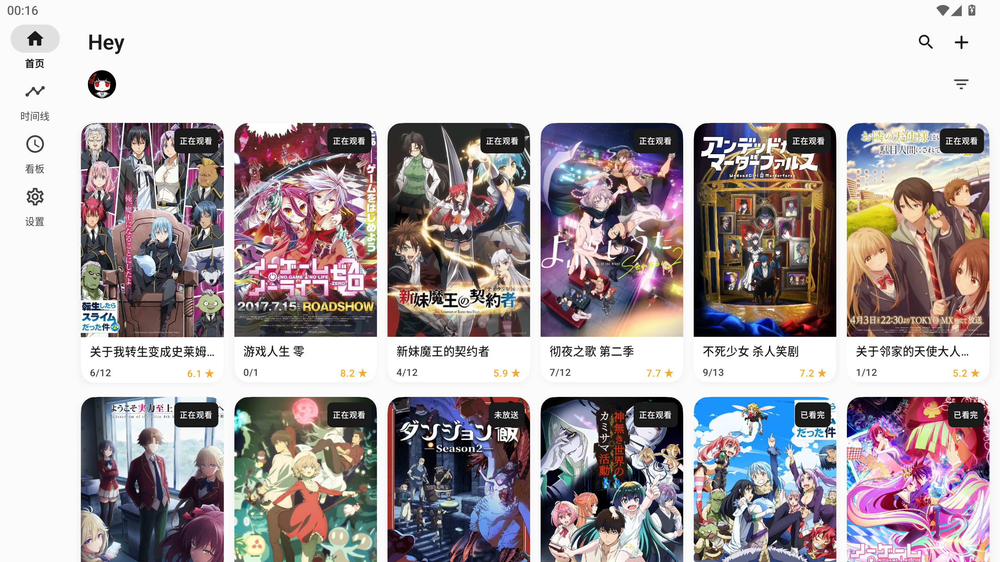
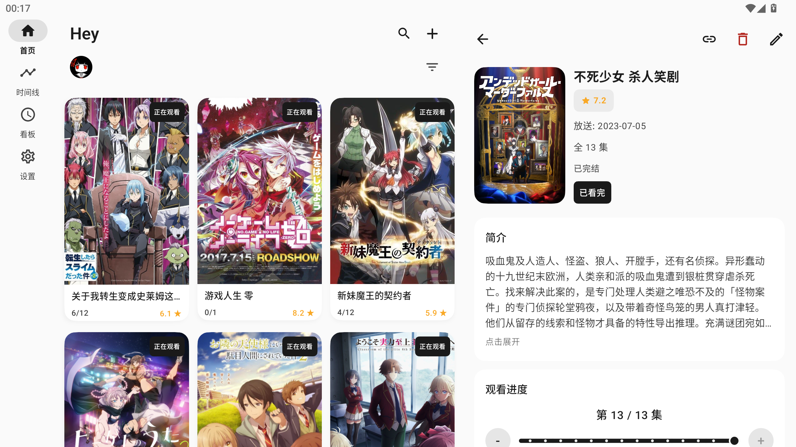

<p align="center">
  
</p>

<p align="center"><strong>看过的，都记得。</strong><br>AnimeTrack 是一款开源 Android 追番应用。整理想看的动画，查每周放送，接着上次的进度继续看。</p>

<p align="center">
  <a href="https://github.com/AieXile/AnimeTrack/releases/latest"><strong>下载 Android APK</strong></a> ·
  <a href="https://github.com/AieXile/AnimeTrack/releases">查看更新日志</a> ·
  <a href="https://github.com/AieXile/AnimeTrack/issues">反馈问题</a>
</p>

<p align="center">
  <a href="https://github.com/AieXile/AnimeTrack/releases/latest"></a>
  <a href="https://github.com/AieXile/AnimeTrack/stargazers"></a>
  
  <a href="LICENSE"></a>
</p>

<p align="center"><strong>简体中文</strong> · <a href="README.en.md">English</a> · <a href="README.ja.md">日本語</a></p>

<p align="center"><a href="#快速上手">快速上手</a> · <a href="#追番与收藏">追番与收藏</a> · <a href="#视频播放">视频播放</a> · <a href="#同步与备份">同步与备份</a> · <a href="#开发与贡献">开发与贡献</a></p>

<table>
  <tr>
    <td align="center"><a href="assets/readme/home.jpg"></a><br><strong>追番主页</strong></td>
    <td align="center"><a href="assets/readme/favorites.jpg"></a><br><strong>收藏夹</strong></td>
    <td align="center"><a href="assets/readme/weekly-board.jpg"></a><br><strong>每周放送</strong></td>
  </tr>
</table>

## 快速上手

[下载 Android APK](https://github.com/AieXile/AnimeTrack/releases/latest)并展开 **Assets**。设备需运行 **Android 8.0（API 26）或更高版本**。

| 安装包 | 适用设备 |
| --- | --- |
| `-v8a.apk` | 大多数新款 Android 手机和平板 |
| `-v7a.apk` | 32 位 ARM 设备 |
| `-universal.apk` | 不确定设备架构时选这个 |

打开 APK 并按系统提示安装。已安装 GitHub 正式版的用户可直接覆盖升级。

- **从第一部开始记。** 点主页的「＋」，搜索番名、选择观看状态，保存后即可在详情页更新集数和评分。
- **带上已有的追番记录。** 可从 Bangumi 或哔哩哔哩导入。在「设置 → 数据管理」可以导入 Markdown 或恢复 WebDAV 备份。各方式的区别见[同步与备份](#同步与备份)。
- **接入自己的视频。** 进入「设置 → 视频播放」，授权本地文件夹、配置 WebDAV 媒体目录，或粘贴兼容的视频地址。可用来源及进度联动规则见[视频播放](#视频播放)。

## 追番与收藏

- **从搜索建起番剧库。** 通过 Bangumi 或 TMDB 查找作品，带入封面、集数和放送日期。支持手动添加，也可以在详情页重新匹配缺失的资料。添加多部作品时，可切换关键词或来源继续勾选，最后一次保存。
- **记住每部作品看到哪一集。** 将番剧标记为「想看」「在看」或「已看」，记录集数、评分与备注。主页支持列表和网格，可搜索、排序或置顶。看完后，按月在时间线回顾补番记录。
- **同一系列集中浏览。** 使用 Bangumi 的前传、续集关系与标题季数识别系列，把对应作品叠在同一张卡片里。滑动切换各季，能直接看到当前这一季的进度。
- **给喜欢的作品单独分组。** 在收藏里新建收藏夹，为它挑一张封面，再拖动调整收藏夹或夹内作品的顺序。打开后可以双指捏合收起。删除收藏夹时，作品仍保留在「全部收藏」。
- **每周哪天更新，打开看板就知道。** 看板按星期列出已添加的连载，点海报可进入详情。今日放送、在看进度和追番统计也可以放到手机桌面。

## 视频播放

内置播放器自 **v1.0.0** 起正式开放。在 **设置 → 功能** 中开启详情页的播放按钮后，可从番剧详情选集。已关联的剧集可直接续播。

| 来源 | 可以做什么 |
| --- | --- |
| 本地文件 | 授权视频文件夹后，自动扫描并按番剧、季和集数整理。支持增量重扫、补全资料、整组确认和手动匹配。 |
| WebDAV | 添加服务器和媒体目录，测试连接后可浏览原有文件夹，或扫描成按番剧排列的媒体库。支持选集、续播和同目录字幕匹配。 |
| 网页 | 粘贴 MP4、HLS（M3U8）或 DASH 等视频直链，或从兼容网页解析剧集与线路。也可导入兼容的 Kazumi HTML / API 规则，按番名搜索。 |
| 外部应用 | 从番剧详情跳转 Animeko 或哔哩哔哩等已适配的应用，具体入口取决于番剧关联和播放器设置。 |

- **媒体库与继续观看。** 按本地、网页和 WebDAV 筛选媒体，也可以把网页番剧加入媒体库，从原剧集继续播放。
- **看完自动记一集。** 开启「看完后更新追番进度」后，已确认关联且集数明确的正片会按有效观看时长判定是否看完，按连续看完的集数推进进度。
- **播放控制。** 竖屏可边看边选集，全屏可按视频比例选择方向。支持快进、亮度和音量手势、长按加速、倍速、画面比例和画中画。可按来源切换可用清晰度、音轨和字幕，也可手动载入本地外挂字幕。
- **WebDAV 有独立的播放设置。** 播放的服务器和媒体根目录在「视频播放」配置，数据备份则在「数据管理」配置。

<p align="center"><a href="assets/readme/player.jpg"></a><br><sub>竖屏播放与选集</sub></p>

## 同步与备份

| 方式 | 适合的场景 |
| --- | --- |
| **AnimeTrack 账号** | 在多台设备间同步追番记录。账号页还可管理头像、登录设备、密码和邮箱。 |
| **Bangumi** | 双向同步收藏状态和观看集数，合并已有标记。 |
| **哔哩哔哩** | 登录后挑选要导入的追番条目，将封面、状态等信息合并到本机。 |
| **WebDAV** | 手动或定时备份，换机时按需覆盖或合并。JSON 备份包含收藏夹和自定义封面，完整 ZIP 还打包番剧封面。 |
| **Markdown** | 从文件或粘贴内容批量导入状态、进度、完成日期和备注，也能把番剧清单导出为可读文本。 |

追番记录保存在本机，可按需使用同步服务。在「数据管理」还可以为缺少封面和简介的番剧重新匹配资料，或扫描并清理重复条目。

## 外观与实用工具

- **界面材质。** 标准、高级模糊、液态玻璃三档可选。支持浅色、四档深色、主题预设和系统动态取色。导航栏可用传统布局或悬浮胶囊，也可调整栏目、图标、字体和部分卡片外观。实时模糊和系统动态取色需要 Android 12（API 31）或以上。
- **手机和平板。** 主页网格随宽度变化。大屏可一边浏览列表、一边查看番剧详情或设置。
- **封面与分享。** 从网络搜索封面、从相册替换、保存到本机，或生成带进度和评分的番剧分享卡片。
- **统计和设置。** 按日、月或年查看使用时长及添加、完结数量。设置支持搜索直达，也可配置 Bangumi 或全局 HTTP 代理。应用内可检查新版本并打开公告。

<details>
<summary>展开查看设置、数据管理和账号界面</summary>

<table>
  <tr>
    <td align="center"><a href="assets/readme/settings.jpg"></a><br><sub>设置与个性化</sub></td>
    <td align="center"><a href="assets/readme/data-management.jpg"></a><br><sub>数据管理</sub></td>
    <td align="center"><a href="assets/readme/account.jpg"></a><br><sub>AnimeTrack 账号</sub></td>
  </tr>
</table>

</details>

<table>
  <tr>
    <td align="center"><a href="update/screenshots/tablet_home.png"></a><br><sub>平板番剧库</sub></td>
    <td align="center"><a href="update/screenshots/tablet_detail_pane.png"></a><br><sub>平板详情双栏</sub></td>
  </tr>
</table>

## 开放协议

[`anime-play://` 规范](docs/ANIME_PLAY_LINK_PROTOCOL.md)供番剧管理和播放应用互相跳转。它使用 Bangumi 条目 ID 标识作品，可以传递集数、Bangumi 剧集 ID 和进度回传地址。接收方适配相应参数后，可以直接打开目标集，或在观看后回传进度。

```text
anime-play://subject/12345?ep=3&src=animetrack
```

AnimeTrack 可作为发送方从番剧详情唤起外部应用。如果你在开发追番或播放工具，可以参考[完整协议文档](docs/ANIME_PLAY_LINK_PROTOCOL.md)中的接入示例、字段和进度回调约定。

## 开发与贡献

客户端使用 Kotlin、Jetpack Compose 和 Material 3。Room 与 DataStore 管理本地数据，WorkManager 处理后台扫描和同步。构建需要 JDK 21 和 Android SDK Platform 37.1。

```sh
./gradlew :app:assembleDebug
```

Windows PowerShell 使用 `.\gradlew.bat :app:assembleDebug`。

前往 [Issues](https://github.com/AieXile/AnimeTrack/issues)反馈问题或讨论需求，也欢迎提交 Pull Request。交流可加入 [Telegram 群](https://t.me/AnimeTrackovo)或 [QQ 群 951059178](https://qun.qq.com/universal-share/share?ac=1&authKey=ToBlat%2BYBVr8R8J4kRqz5dZrwO08fUn1zJ47jsHDUmn04oxTLfipUhzDJNijY%2F3P&busi_data=eyJncm91cENvZGUiOiI5NTEwNTkxNzgiLCJ0b2tlbiI6IlgwRENkOGxubGFFOVd2cHZyRXNyQWsyU3VNb05DZ3ltNXpmUlg5T1NhQlh4emNoSDU1YnhWOWtUT2tFd1JLYlMiLCJ1aW4iOiIxMjE5NTc2NDA4In0%3D&data=f0HExdxeoQoLo-3m3KP-nlq9fIdMzKA3V5heiCbyagsnJqZRpLtjMq0yZ4W7BFNzDW9f17-YL24xP87SezjzCQ&svctype=4&tempid=h5_group_info)。

## 许可证

客户端按 [Apache License 2.0](LICENSE) 分发。文件名解析使用的 kotlin-anitomy 源码遵循 [MPL 2.0](app/src/main/assets/kotlin-anitomy-NOTICE.txt)，部分网页规则的来源见[授权声明](app/src/main/assets/websource/KazumiRules-NOTICE.txt)。
